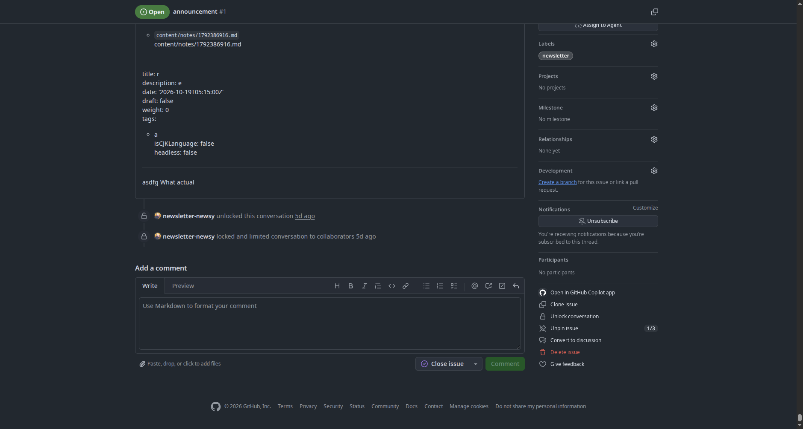
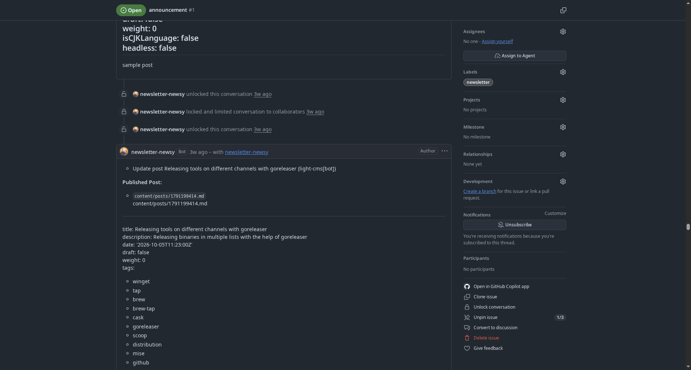

Introduction à [Newsy](https://newsy.lightcms.me), une plateforme de newsletter open-source propulsée par GitHub.

Newsy est fortement inspiré par des outils tels que Utterances, Giscus et Gitalk, qui ont réimaginé les commentaires de sites statiques utilisant GitHub Issues.
Newsy adopte la même approche basée sur GitHub et l'apporte aux newsletters :
au lieu de s'appuyer sur des services externes ou de maintenir une liste de diffusion séparée
votre newsletter vit à côté de votre code dans votre dépôt GitHub.

Why GitHub?

1. Votre newsletter vit à côté de votre code dans votre dépôt GitHub.
2. Pas de gestion de listes de diffusion. Les abonnés et les mises à jour sont suivis dans GitHub.
3. Aucune API email coûteuse. Vous n'avez pas besoin d'un service d'abonnement à des e-mails séparé.
4. Aucune configuration d'envoi de courriel. Vous n'avez pas besoin de gérer les SMTP, les filtres anti-spam ou la réputation du domaine.
5. Aucune base de données d'abonnement. Vous n'avez pas besoin d'une base de données séparée pour les abonnements et les désabonnements.
6. Vous vous concentrez sur l'écriture. GitHub et Newsy s'occupent du reste.

La publication doit être accessible à tous. Il n'est pas nécessaire de payer des frais élevés à une plateforme SaaS ou de passer des heures à lutter avec l'infrastructure de messagerie simplement pour partager les mises à jour avec vos lecteurs.

- Déploie sur serveur sans serveur (par exemple, Vercel, AWS Lambda) pour la production.
- Prise en charge de WebAssembly : Compiler le binaire Go vers WebAssembly avec [TinyGo](https://tinygo.org/) et l'exécuter sur des plates-formes sans serveur qui prennent en charge les exécutions JavaScript ou TypeScript.

Une présentation vidéo de la configuration locale est disponible dans le [guide vidéo](/content/misc/newsy/video.md).

## Héberger votre Bot

Suivez ces étapes pour exécuter Newsy et le connecter à vos dépôts GitHub.

#### 1. Cloner le dépôt

```bash
git clone git@github.com:light-cms/newsy.git
newsy cd
```

#### 2. Mettre en place l'environnement

Nous utilisons [mise](https://mise.jdx.dev) pour maintenir l'environnement de développement
cohérent et facile à gérer :

```bash
mise deps
```

#### 3. Construire et exécuter

Construire et exécuter le binaire Go :

```bash
allez construire
./newsy
```

#### 4. Configure the GitHub App

1. Ouvrez [http://localhost:3000](http://localhost:3000) dans votre navigateur.
2. Si vous avez besoin d'exposer votre serveur local, utilisez un service de tunneling tel que [ngrok](https://ngrok.com),
   [Tunnel de Fusée nuageuse](https://developers.cloudflare.com/cloudflare-one/networks/connectors/cloudflare-tunnel/),
   ou SSH tunneling via [localhost.run](http://localhost.run/):

```bash
ssh -R 80:localhost:3000 localhost.run
```

3. Ouvrez l'URL de votre tunnel (par exemple, `https://xyz.localhost.run`) dans votre navigateur:

[](https://youtu.be/sfjo6ZVgC9w)

_(Si vous rencontrez des problèmes, reportez-vous au [guide vidéo](/guides/newsy/video/) ou essayez un fournisseur alternatif de tunneling.)_

4. Choisissez un **nom de l'application** (de préférence unique).
5. Collez l'URL du tunnel dans le champ **Webhook URL** et soumettez-le.
6. Un fichier `.env` contenant les secrets de votre application sera généré à la racine de votre projet. Garder ce fichier en sécurité.

Le fichier `.env` généré devrait ressembler à ceci :

```bash
APP_ID=""
WEBHOOK_SECRET=""
PRIVATE_KEY=""
DATABASE_URL=""
```

> \[!IMPORTANT\]
> Installez l'application GitHub sur **des dépôts spécifiques**, plutôt que sur "Tous les dépôts".

Chaque instance de Newsy peut être partagée entre plusieurs dépôts ou utilisateurs.

> \[!NOTE\]
> Par défaut, Newsy ne déclenche que les commentaires et les problèmes lors de la création de nouveaux fichiers de contenu (`. tml`, `.md`, `.mdx`, etc.), plutôt que sur les modifications suivantes.

---

## Essayez Newsy via l'instance hébergée

Vous pouvez tester Newsy directement en utilisant la version hébergée : [https://newsy.lightcms.me](https://newsy.lightcms.me)

[](https://youtu.be/3d1xLYkeVsA)

---

## Déployer sur Vercel


Une fois déployé, mettez à jour l'URL du Webhook de votre application GitHub depuis `*.localhost.run` vers votre domaine de production : `https://<your-app>.vercel.app`.

> \[!AVERTISSEMENT \]
> N'utilisez le bouton de déploiement que si vous avez déjà une application GitHub configurée et que ses identifiants sont prêts. Sinon, suivez les étapes de [Self-Host Your Bot](#self-host-your-bot) pour en créer un.

---

## Operating Costs &amp; Resource Usage

Vercel et de nombreux autres fournisseurs de cloud offrent des tiers gratuits pour des charges de travail sans serveur. Vous pouvez également héberger Newsy sur des exécutions JavaScript ou TypeScript-only en compilant le binaire Go vers WebAssembly avec [TinyGo](https://tinygo.org/).

Parce que c'est un binaire Go compilé :
- **Faible empreinte mémoire**, en restant confortablement dans la mémoire sans serveur et les limites d'exécution.

---

## S'abonner à la Newsletter

Abonnez-vous pour voir les Newsy en action :

👉 [**Subscribe on GitHub**](https://github.com/Pratyay360/blogs_md/issues/1)

---

## Générer votre bouton d'abonnement

Générez un bouton d'abonnement intégré pour votre compte à [newsy.lightcms.me](https://newsy.lightcms.me/).

Vous pouvez personnaliser et styliser le bouton en utilisant [Primer CSS](https://cdnjs.com/libraries/Primer).

> \[!TIP\]
> **Conseil de sécurité :** Après la publication de son premier message de newsletter, verrouillez la conversation pour éviter tout comportement involontaire.





Pour plus de détails sur les permissions, reportez-vous à la documentation [autorisations requises](/guides/newsy/list-of-all-permission/).
